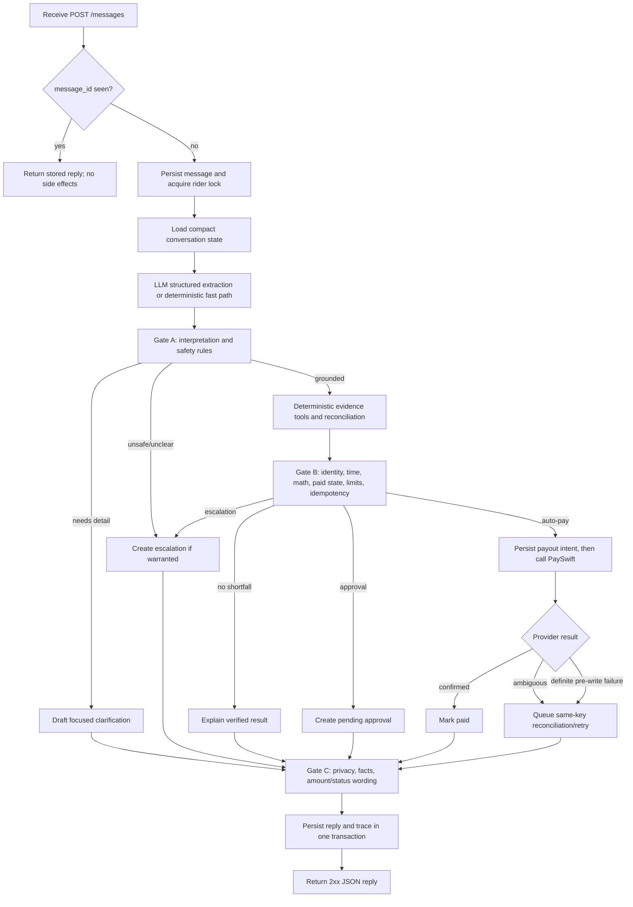

# Fast and reliable conversation workflow

## 1. Operating model

Use a hybrid pipeline:

- The LLM understands language, extracts claims, links turns, and drafts replies.
- Deterministic tools load evidence and compute entitlement.
- A non-LLM rule engine makes every money, approval, escalation, identity, window, and provider-state decision.
- Human ops approves known high/repeat amounts and handles unclear facts, exceptions, or security cases.

The runtime, not the LLM, owns the final state represented by `response_classification.schema.json`.



## 2. Per-message stages

### Stage 0 — ingress and idempotency

1. Validate `message_id`, envelope `rider_id`, `text`, and timezone-aware `received_at`.
2. Insert the message under a unique `message_id`.
3. If it already exists:
   - Return its stored reply.
   - Do not invoke the LLM, create disputes/ops items, or call PaySwift.
   - If the first request is still processing, wait briefly for its result; otherwise return a stable “still processing” reply linked to the same logical message.
4. Acquire a per-rider transaction/advisory lock before changing conversation or dispute state.
5. Record `message_in` in the trace.

### Stage 1 — compact context

Load only:

- Envelope identity and current message.
- Open disputes and their verified status.
- A compact summary of relevant prior turns.
- Any pending approval/escalation/payout for this rider.
- Previous auto-payment status for the message's IST day.

Do not send full rider history or unrelated records to the model.

### Stage 2 — interpretation

Use deterministic fast paths first:

- Duplicate message.
- “When will it arrive?” linked to a known payout.
- Simple thank-you/greeting.
- Exact trip-ID patterns and unambiguous numeric dates.

Use one structured LLM call for ambiguous language, multi-turn linking, multiple allegations, Hinglish/date resolution, or intent detection. Validate its output against `contracts/model_interpretation.schema.json`; retry once with validation errors, then fail safe. Deterministic code later assembles the full `response_classification.schema.json` runtime envelope.

The model produces only interpretation/proposed response fields. It does not mark the deterministic rule gate passed and does not populate unverified payment success.

### Stage 3 — Gate A: deterministic interpretation check

Run code checks immediately after model parsing:

| Rule | Failure behavior |
|---|---|
| Envelope rider is a known canonical rider | Generic failure/escalation; no private lookup |
| Text does not change envelope identity | Flag identity switch; no cross-account action |
| Prompt-injection/sensitive request flags are honored | Ignore instructions; optional security escalation |
| Dates are resolved from `received_at` in IST | Ask clarification if ambiguous |
| Trip IDs and dates are syntactically valid | Ask for correction/clarification |
| Multi-claim grouping follows same date/cause rule | Split or merge deterministically |
| Essential grounding exists | Ask one focused clarification |

### Stage 4 — evidence and reconciliation tools

Tools should be narrow and typed:

1. `get_rider(rider_id)`
2. `get_trip(trip_id)` / `list_rider_trips(rider_id, date_ist)`
3. `get_paid_lines(rider_id, trip_ids, date_ist, line_type)`
4. `calculate_entitlement(trips, policy_version)`
5. `get_payswift_payouts(rider_id)`
6. `get_open_actions(rider_id)`

On import:

- Preserve raw records.
- Canonicalize rider IDs only through an unambiguous roster mapping.
- Convert UTC timestamps to IST.
- Normalize metre-like distances with the approved rule and validate plausibility.
- Collapse exact duplicate trip rows for calculations.
- Escalate conflicting duplicate rows.

For each grounded dispute, compute expected components, actual components, and `max(expected - actual, 0)`. Evidence IDs must make the result reproducible.

### Stage 5 — Gate B: non-LLM pre-action rule check

This is the requested manual-rule stage outside LLM judgment. Implement the rules as explicit, versioned code and save each pass/fail result.

Before any monetary or ops action, verify:

1. The message is not a duplicate already handled.
2. The dispute grouping is valid and stable.
3. Every trip belongs to the envelope rider after approved normalization.
4. Every service date is within the seven-date IST window.
5. Source rows are present, non-conflicting, and normalized only by approved rules.
6. Fare/incentive/penalty arithmetic was recomputed by the policy engine.
7. Verified shortfall is a positive whole-rupee amount.
8. Proposed amount equals the verified shortfall and never the alleged amount.
9. Historical payout lines and current PaySwift ledger do not already cover the shortfall.
10. The immutable PaySwift request fingerprint matches any existing idempotency record.
11. Auto-pay amount is at most ₹200.
12. No earlier dispute has been auto-paid for the rider on the same IST action day.
13. The classification is correct:
    - known amount blocked only by limit/repeat → approval;
    - unclear facts/ownership/data/exception/security → escalation with null amount;
    - supported zero shortfall → explanation;
    - all checks pass → auto-pay.

Any failed blocking rule prevents a payout even if the LLM recommended one.

### Stage 6 — durable action

In one database transaction:

- Save the deterministic decision and its rule version.
- For approval/escalation, create exactly one pending item using a uniqueness key tied to the dispute and decision version.
- For auto-pay, create a payout-intent/outbox row with:
  - stable idempotency key;
  - immutable rider/amount/reference fingerprint;
  - `queued` state;
  - attempt count zero.

Commit before making a network call. This prevents a crash between provider success and local persistence from losing the intent.

### Stage 7 — PaySwift execution and ambiguity handling

1. Use the persisted key and exact same body on every retry.
2. Query the rider's PaySwift ledger before first send when local/provider state may differ.
3. On 201 or same-key 200, persist provider ID/status and mark confirmed.
4. On timeout, 504, connection loss, 409 `request_in_progress`, or other ambiguous result:
   - Do not create a new key.
   - Do not say payment failed or succeeded.
   - Query `GET /v1/payouts?rider_id=...` and match the immutable reference/fingerprint.
   - Retry the same key/body with bounded exponential backoff and jitter.
5. On 429, respect a cooldown; avoid retry storms.
6. On 503, retry through the durable worker.
7. A lost response may mean money already moved. Ledger reconciliation always precedes any alternative action.
8. When retry budget is exhausted, create a provider-failure escalation and retain the same payout intent for safe operator retry.

### Stage 8 — reply drafting and Gate C

Prefer deterministic templates for payment/approval/status statements and allow the LLM only to adapt language/tone.

The non-LLM reply gate verifies:

- Every mentioned trip/date/count/amount is supported by the rider's own evidence.
- No other-rider data appears.
- “Paid/processed” is used only for provider-confirmed or ledger-confirmed payouts.
- “Awaiting approval” maps to an existing pending approval.
- “Escalated” maps to an existing pending escalation.
- A processing reply names no false success and tells the rider the system is still checking.
- The reply is non-empty, concise, and contains the requested clarification or next step.

Persist the final `reply` trace and response before releasing the rider lock and returning 2xx.

## 3. Latency budget

The vendor retries near 10 seconds, so target p95 under 6 seconds and hard-stop synchronous work by roughly 8.5 seconds.

| Work | Target |
|---|---:|
| Validation, dedupe, lock, context | 100–250 ms |
| One LLM extraction call | 1–2.5 s |
| Local evidence/reconciliation/gates | 100–500 ms |
| First PaySwift attempt/reconcile | up to 3–4 s of remaining budget |
| Reply gate, persist, serialize | under 250 ms |

If PaySwift enters its eight-second slow path, return an honest processing response before the vendor deadline and let the durable worker reconcile. The eval runner should poll for a bounded period when the returned status is processing.

## 4. Conversation state and follow-ups

Recommended dispute state transitions:

```text
draft -> needs_clarification -> verifying
verifying -> verified_not_owed -> closed
verifying -> verified_owed -> payout_processing -> paid -> closed
verified_owed -> awaiting_approval -> paid|rejected -> closed
any unresolved/unsafe state -> escalated -> closed
```

Rules:

- A new message may contain a new dispute while an old one remains open.
- A status question must reference the most recent relevant open/closed action, not rerun payment.
- A changed story creates a new claim revision; it does not erase evidence or previous decisions.
- Rider disagreement may reopen verification or add an escalation, but never silently changes an amount.
- Once an issue is paid, later duplicate/rephrased complaints reconcile against PaySwift and explain the existing payout.

## 5. Human ops workflow

### Approval

Show verified evidence, calculation, reason for manual approval, prior auto-payment status, and complete trace. On approve:

1. Lock the pending item and confirm it is still pending.
2. Rerun Gate B and PaySwift reconciliation.
3. If the shortfall is already paid or changed, close as stale and do not pay.
4. Persist the human decision and payout intent, then use normal idempotent execution.

On reject, store reviewer, timestamp, reason, and send/queue a factual rider reply. A rejected item cannot later auto-pay without a new versioned decision.

### Escalation

Show the exact missing/conflicting fact and safe suggested next action. Ops may resolve the source fact, grant/deny a documented exception, or close the case. If ops establishes a payable amount, create a new verified decision and rerun all gates; do not mutate an unknown escalation directly into an unchecked payout.

## 6. Reliability and observability checklist

- Database unique constraints: `message_id`, logical ops-item key, payout idempotency key, provider payout ID.
- Row/advisory locks for rider state and pending-item actions.
- Transactional outbox for provider work.
- Bounded retries with jitter and explicit terminal/provider-ambiguous states.
- Structured logs with trace/dispute IDs but no secrets.
- Metrics: message latency, duplicate rate, LLM schema failures, clarification rate, approval/escalation rate, payout attempts, ambiguous provider results, reconciliation recoveries, and rule-gate failures.
- Health/readiness checks for database and worker readiness; do not make readiness depend on PaySwift being perfectly healthy.
- Templates/fallback parser when the LLM is unavailable; money remains blocked unless deterministic evidence and gates are complete.
